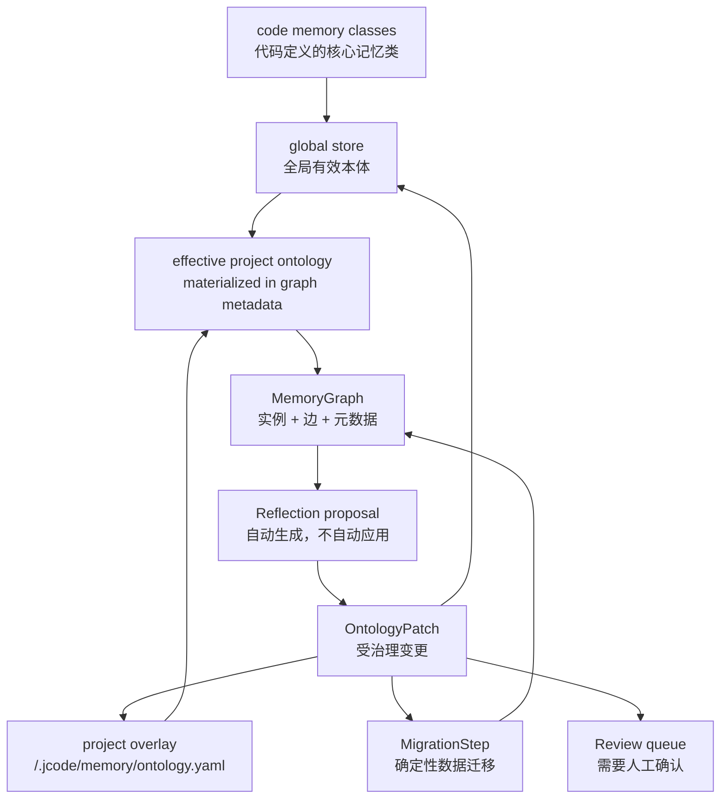
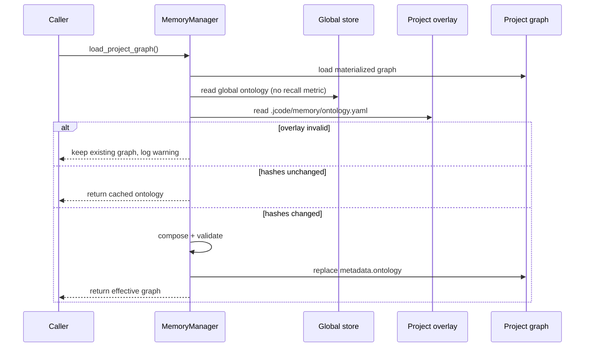
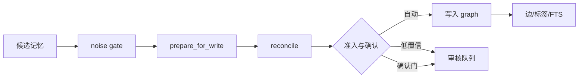

# 本体记忆管理设计说明

状态：已实现，2026-11-10

本文描述 jcode 当前的本体记忆管理，不描述早期方案。重点回答四个问题：

1. 记忆的“类型”和约束由什么定义；
2. 全局通用概念与项目专有概念如何共存；
3. 运行时如何得到一份可执行的有效本体；
4. 本体变更、数据迁移、回滚和自动反思如何保证安全。

相关文档：

- [MEMORY_ARCHITECTURE.md](./MEMORY_ARCHITECTURE.md)：记忆存取、召回、写入与技能联动总览。
- [MEMORY_ONTOLOGY_RUNTIME.md](./MEMORY_ONTOLOGY_RUNTIME.md)：运行时本体、补丁、迁移和项目覆盖层。
- [plans/LAYERED_ONTOLOGY.md](./plans/LAYERED_ONTOLOGY.md)：分层本体的设计与实施阶段。
- [CODE_ONTOLOGY_BRIDGE.md](./CODE_ONTOLOGY_BRIDGE.md)：代码概念与本体的设计时桥接，不是运行时记忆路径。

## 1. 设计目标

本体记忆管理不是“给记忆加一个标签”，而是让类型定义驱动记忆的写入、抽取、评分、生命周期和检索。当前实现遵循以下不变量：

1. **业务概念是一等数据，记忆管理类不是**。运行时总结出的业务概念，其类型、属性、关系、规则、活动和生命周期策略可以持久化、校验、版本化和迁移；`env_fact`、`contract`、`process_rule` 等记忆管理类由代码定义，不从本体数据加载，也不允许通过补丁改写。
2. **实例与模式分离**。`MemoryEntry` 是实例，`Ontology` 是模式；实例存储自己的 `category`、属性、来源和状态，模式决定如何解释它们。
3. **全局与项目隔离，但不割裂**。项目继承全局通用概念，只把项目专有概念写进项目覆盖层。项目本体不进入全局 store。
4. **每次变更都可审计**。补丁带 base id/version/hash，应用前校验，应用后递增版本，破坏性操作必须声明数据迁移。
5. **自动只到提案**。自动反思、技能蒸馏只写提案或草稿，不自动应用本体变更，不自动安装技能。
6. **本地确定性优先**。迁移、分类、TTL、写入调和都不需要 embedder 或 LLM；召回也不依赖抽取可用性。
7. **失败关闭，读取降级**。非法补丁不得写入；非法项目覆盖层被忽略并记录日志，不阻塞记忆读取。
8. **不批量重命名已存类别字符串**。旧类别通过 alias 和显式迁移收敛，不用一次性文本替换破坏历史数据。

## 2. 概念模型



核心对象：

| 对象 | 作用 | 代码位置 |
|---|---|---|
| `Ontology` | 业务概念模式：持久化的业务类型、关系、规则、活动、类别别名 | `crates/jcode-memory-types/src/ontology.rs` |
| `memory_class` | 代码定义的核心记忆类及其评分、TTL、抽取策略；不进入本体数据 | `crates/jcode-memory-types/src/memory_class.rs` |
| `OntologyType` | 单个类型的属性、父类型、评分、衰减、TTL、抽取方法 | 同上 |
| `OntologyLayer` | 部分本体：新增/覆盖类型、字段补丁、禁用项、关系/规则/活动 | `crates/jcode-memory-types/src/layered.rs` |
| `MemoryGraph` | 一个 store 的实例、边、标签、统计和本体元数据 | `crates/jcode-memory-types/src/graph.rs` |
| `GraphMetadata` | 有效本体、内容哈希、父哈希、层哈希、历史、迁移状态 | 同上 |
| `OntologyPatch` | 对本体的一次声明式变更 | `crates/jcode-memory-types/src/migration.rs` |
| `MigrationStep` | 与模式变更配套的数据迁移 | 同上 |
| `MemoryReviewItem` | 待人工确认的写入或变更 | `crates/jcode-memory-types/src/review.rs` |
| `Effect` / `Rule` | 事件驱动的声明式行为 | `crates/jcode-memory-types/src/ontology.rs` |

### 2.1 职责边界

本体库只存“jcode 运行过程中总结出来的业务概念”，例如某个项目的发票流程、某个服务的部署约束、某组 API 的领域实体。它不存记忆管理自身的类定义。

两类对象的边界：

| 对象 | 存放位置 | 是否持久化 | 是否可通过本体补丁修改 |
|---|---|---|---|
| 核心记忆类：`env_fact`、`contract`、`process_rule`、`observation`、`preference`、`entity`、`correction` | `memory_class.rs` | 否，随二进制发布 | 否，必须改代码并发布新版本 |
| 业务概念类型：`acme.billing.invoice_flow`、`cloud.service` 等 | `Ontology.types` | 是 | 是，受补丁、项目覆盖层和迁移校验约束 |

运行时通过 `Ontology::get_type`、`Ontology::all_types` 和 `Ontology::type_from_category` 同时解析两类对象。旧 store 中残留的核心类型和核心类别别名在反序列化时剥离，默认本体版本因此升到 4。

## 3. 本体结构

`Ontology` 的字段（`types` 只表示持久化的业务概念）：

```rust
pub struct Ontology {
    pub id: String,
    pub version: u32,
    pub description: String,
    pub types: BTreeMap<String, OntologyType>,
    pub relationships: BTreeMap<String, RelationshipDef>,
    pub rules: Vec<Rule>,
    pub activities: Vec<Activity>,
    pub category_aliases: HashMap<String, String>,
}
```

`OntologyType` 的字段：

| 字段 | 含义 |
|---|---|
| `id` | 稳定类型 id；项目/领域类型建议带命名空间 |
| `display_name` | 展示名 |
| `description` | 抽取提示和 `ontology show` 使用的说明 |
| `parent` | 父类型；属性通过 `effective_properties` 继承 |
| `legacy_category` | 旧 `MemoryCategory` 名称到该类型的映射 |
| `properties` | 本地属性定义；父类型属性另行继承 |
| `lifecycle` | 状态机与状态转换 |
| `scoring` | 基础分、信任乘数、强度乘数 |
| `decay` | 半衰期与访问加成 |
| `ttl_days` | 硬 TTL；空闲超过该天数由 GC 归档 |
| `extraction_methods` | 允许的抽取来源及准入判断 |
| `persistent` | 是否允许写入 store；链接节点类型通常为 false |
| `embeddable` | 是否为实例生成 embedding |
| `present_in_prompt` | 是否出现在提示词/抽取类型目录中 |

### 3.1 默认类型

默认本体 id 为 `jcode/default/v1`，版本为 4。`Ontology.types` 默认为空；以下七个核心记忆类由 `memory_class::core_memory_classes()` 在代码中定义：

| 类型 | TTL | base_score | half_life | 说明 |
|---|---:|---:|---:|---|
| `env_fact` | 14 天 | 8 | 7 天 | 只对某机器/工作区成立的易腐事实 |
| `contract` | 无 | 40 | 180 天 | API、字段、枚举、payload 等接口契约 |
| `process_rule` | 无 | 45 | 365 天 | must/never/正确做法等工作流知识 |
| `observation` | 90 天 | 20 | 45 天 | 低权威残差桶 |
| `preference` | 无 | 20 | 90 天 | 用户偏好 |
| `entity` | 无 | 35 | 180 天 | 值得跟踪的命名实体 |
| `correction` | 无 | 50 | 365 天 | 被纠正的错误、错误假设、错误流程 |

注意：旧架构文档曾把 `env_fact` 写成 30 天，当前实现是 14 天。

这些类不是本体数据。`OntologyPatch` 的 `add_type`、`update_type`、`remove_type` 和 `set_category_alias` 一旦指向核心类或核心类别，都会被拒绝；项目覆盖层同样不能定义、禁用或补丁核心类。

`goal:` 和 `skill:` 不是可抽取类型，而是外部工件的镜像链接节点。它们跳过写入调和、TTL GC 和聚类，只注入有界指针。

### 3.2 关系、规则、活动

默认关系：

- `has_tag`：实例到标签节点；
- `relates_to`：实例间弱关联，可带权重；
- `supersedes`：新实例替代旧实例；
- `contradicts`：冲突；
- `derived_from`：技能/结论来源于证据；
- `in_cluster`：已弃用，仅保留历史边可解析。

默认规则覆盖：

- 写入校验、全局写入通用性门、upsert、去重强化、替代、矛盾、打标签、建边；
- 写时调和阈值：`reinforce_at=0.85`、`supersede_at=0.5`、`relate_at=0.4`；
- 技能执行结果验证/失效规则。

默认活动与触发事件：

- `activity.write_reconcile`：`event.remember`，写入时本地调和；
- `activity.final_extract`：`event.finalize`，会话结束抽取；
- `activity.periodic_gc`：`event.finalize`，TTL 归档；
- `activity.skill_distill`：`event.finalize`，技能证据蒸馏。

## 4. 分层与作用域

### 4.1 三层模型

```text
core        编译内置，随二进制发布
global      ~/.jcode/memory/... 中的全局本体，可被补丁修改
project     <repo>/.jcode/memory/ontology.yaml，仓库内可审查
```

有效本体：

```text
global scope  = global store 本体（首次加载时从 core 绑定）
project scope = compose(global 有效本体, project overlay)
```

当前实现中，全局通用概念通过全局 store 的本体管理；`core` 是编译内置默认值。全局领域包目录 `~/.jcode/memory/ontology/layers/*.yaml` 尚未接入运行时，属于后续阶段。

在当前实现中增加一个全局通用概念，使用 global scope 的本体补丁，例如：

```json
{
  "base_id": "jcode/default/v1",
  "base_version": 3,
  "base_hash": "",
  "rationale": "add cloud service concept",
  "ops": [
    {
      "op": "add_type",
      "type_def": {
        "id": "cloud.service",
        "display_name": "Cloud service",
        "parent": "entity",
        "description": "A managed cloud service, deployment target or infrastructure component."
      }
    }
  ],
  "migrations": []
}
```

```bash
jcode memory ontology apply cloud-service.json --scope global --apply
```

项目加载时会从全局有效本体继承该类型，不需要复制。项目专有概念则写入项目覆盖层。

### 4.2 项目覆盖层

路径：

```text
<repo>/.jcode/memory/ontology.yaml
```

示例：

```yaml
id: project/acme-billing
version: 4
priority: 100
namespace: acme.billing
types:
  acme.billing.invoice_flow:
    display_name: Invoice flow
    parent: contract
    description: Invoice generation and settlement procedure.
type_patches:
  acme.billing.invoice_flow:
    ttl_days: 45.0
```

合并规则：

1. 按 `priority` 升序合并，同优先级按文件/层顺序稳定排序。
2. `types` 新增或完整替换类型；`parent` 继承应优先于复制父类型字段。
3. `type_patches` 字段级覆盖。项目只改 `acme.billing.invoice_flow.ttl_days` 时，全局后续修改该类型的 `scoring` 仍会流入项目。核心记忆类不能被 `type_patches` 指向。
4. `properties` 补丁是**整体替换**属性列表，不是逐属性合并。
5. `disabled_types` 从有效本体移除业务类型；重复禁用是幂等的。核心记忆类不能被禁用。
6. 关系、规则、活动按 id 去重，后层覆盖前层。
7. `category_aliases` 并集，冲突时后层优先。
8. 有效本体版本取 `max(base.version, layer.version)`；内容哈希覆盖合并结果。

### 4.3 项目覆盖层的信任边界

项目文件来自仓库，属于不可信输入。当前实现：

- 加载项目覆盖层时清空 `rules`、`activities`、`disabled_rules`、`disabled_activities`；
- 项目补丁若包含 `add_rule`、`remove_rule`、`add_activity`、`remove_activity`，直接拒绝，要求使用 global scope；
- 项目覆盖层可以新增类型、字段补丁、禁用类型、关系和类别别名。

这保证了克隆一个仓库不会通过记忆规则改变其他项目或本项目的记忆副作用。

### 4.4 全局与项目隔离

- 项目 store 能读取全局记忆和项目记忆；
- 全局 store 永远看不到项目专有类型或实例；
- 项目本体不会安装到进程级 `OntologyRegistry`；
- 只有 global scope 的本体补丁会更新进程级默认本体。

### 4.5 旧快照的安全迁移

旧项目 store 可能保存一份完整本体快照。首次加载时：

- 如果没有覆盖层，且快照等于编译默认本体，或快照中的类型/关系/规则/活动/别名都只是当前全局本体的同定义子集，则视为过期副本，直接使用全局有效本体；
- 如果快照相对当前全局本体是**纯增量**：全局类型、关系、规则、活动、别名都不变，只多出项目类型，则写成一个 `project/legacy-adopted` 覆盖层；
- 快照中的核心类型和核心类别别名在读取时被剥离；剥离后若只剩业务概念，按上面的纯增量规则处理。旧核心 TTL 等覆盖不会再生效，核心行为始终以当前代码为准。

这样可以统一大多数“项目只新增概念”的旧 store，同时避免把旧核心定义永久钉进仓库。

## 5. 存储与元数据

### 5.1 存储后端

默认 SQLite 后端：

```text
~/.jcode/memory/backend-sqlite/gvec.sqlite
```

- 每个项目一个 graph，store key 为 `project:<hash>`；
- 全局 graph 的 store key 为 `global`；
- FTS5 表用于全文检索；
- `jcode_graph_meta` 保存最近写入来源。

JSON 回退：

```text
~/.jcode/memory/global.json
~/.jcode/memory/projects/<project-hash>.json
```

旧 JSON store 在 SQLite 为空时一次性导入，随后源文件重命名，避免删除后复活。

其他路径：

```text
~/.jcode/memory/reviews/pending.jsonl                     # 人工审核队列
~/.jcode/memory/ontology/.proposals/                      # 本体提案
~/.jcode/memory/ontology/.reflection-<project-key>.json   # 自动反思节流状态
```

### 5.2 图元数据

`GraphMetadata` 中与本管理相关的字段：

```rust
pub ontology_id: String,
pub ontology_version: u32,
pub ontology: Option<Ontology>,          // 物化的有效本体
pub ontology_hash: String,               // 有效本体的内容哈希
pub ontology_parent_hash: String,        // 项目覆盖层的父本体哈希
pub ontology_layer_hash: String,         // 项目覆盖层栈哈希
pub ontology_layer_ids: Vec<String>,     // 层来源，供 show/诊断
pub ontology_history: Vec<OntologySnapshot>,
pub applied_migrations: Vec<String>,
pub migration_state: Option<MigrationState>,
```

物化本体是**缓存/快照**，不是唯一事实来源：

- 项目 scope 的事实来源是全局有效本体 + 项目覆盖层；
- 全局 scope 的事实来源是全局 store 中的本体；
- 父哈希或层哈希变化时，下次加载重新合成。

### 5.3 哈希与失效

`Ontology::content_hash()` 使用排序后的 canonical view 计算 FNV-1a，避免 `HashMap` 顺序导致哈希不稳定。层栈哈希 `layer_stack_hash(&layers)` 同样按稳定序列化计算。

项目加载时：

1. 读取全局有效本体；
2. 读取项目覆盖层；
3. 如果 `ontology_parent_hash` 和 `ontology_layer_hash` 与当前一致，复用物化本体；
4. 否则重新合成、校验、替换 `metadata.ontology`；
5. 在下一次正常保存时持久化。

加载合成路径使用 `global_ontology_for_composition()` 读取全局本体，不增加全局召回计数，避免把项目加载误计为用户召回。

## 6. 运行时解析

### 6.1 解析入口

```rust
pub fn ontology_for_graph(&self, graph: &MemoryGraph) -> Arc<Ontology>
```

规则：

- `metadata.ontology` 存在则直接使用；
- 否则回退到进程级 `OntologyRegistry` 的默认本体；
- 项目图在 `load_project_graph()` 包装层中先合成覆盖层，再进入调用方。

`stored_ontology(scope)` 返回该 scope 的有效本体。`ontology_layer_status(scope)` 返回层 id 列表和父哈希，用于 CLI 展示。

### 6.2 加载流程



失败策略：

- 覆盖层 YAML 非法：记录警告，忽略覆盖层，不阻塞记忆读取；
- 覆盖层引用了不存在的父类型、别名指向不存在类型等：合成校验失败，同样忽略并保留旧物化本体；
- 补丁应用失败：错误返回，不写入。

## 7. 写入与抽取

### 7.1 抽取类型目录

抽取器先得到有效本体，再生成提示词：

- 七个核心记忆类保留静态详细说明（由代码定义，不依赖持久化类型表）；
- `present_in_prompt=true` 且 `persistent=true` 的额外类型追加到提示词；
- 带点的领域/项目类型优先，最多 40 个；
- 每个额外类型包含 id、display_name、description、parent；
- 模型必须返回精确类型 id；
- 返回的未知类型以 `MemoryCategory::Custom(id)` 存储，不会被静默降级为 `fact`。

`MemoryCategory` 仍是枚举，但 `Custom(String)` 已经能往返任意类型 id；分类、TTL 和评分通过 `Ontology::type_from_category` 解析。

### 7.2 写入流水线



关键步骤：

1. **噪声门**：拒绝工具 payload、裸标识符、过短 stub、commit hash 等。
2. **prepare_for_write**：派生 `subject_key`、清洗标签、规范化类别、降级无身份实体。
3. **reconcile**：词面相似度和锚点决定 `Contradict` / `Reinforce` / `Supersede` / `Relate` / `Insert`。
4. **准入分层**：
   - `UserStated`、`StructuredMapping` 直接准入；
   - 其他方法置信度 `>= 0.9` 直接准入；
   - `0.7 <= confidence < 0.9` 准入但标记 `needs_review`；
   - `< 0.7` 进入持久审核队列，不修改 graph。
5. **确认门**：
   - G1 关键数据；
   - G2 权威覆盖；
   - G3 状态转换/删除；
   - G4 批量变更；
   - G5 技能升级；
   - G6 权威矛盾。
   触发任一门即入审核队列。
6. **G4 批量阈值**：单批同一类别超过 5 条，或超过该类别现有 active 行数的 20%。
7. **权威顺序**：`UserStated 5 > StructuredMapping 4 > RuleExtraction/SkillInvocation 3 > LlmExtraction 2 > RuleInference 1`。

审核项写入 `reviews/pending.jsonl`，接受时补记 reviewer、确认时间和更高置信度。

### 7.3 确定性重分类

`reclassify_project_store(apply=true)` 只处理残差行，即当前映射到 `observation` 的行：

- 规则标记（must/never/必须/不得/流程/规范等）→ `process_rule`；
- 接口标记（`/api/`、GET/POST、schema、payload、枚举等）→ `contract`；
- 环境标记（`localhost:`、IP、绝对路径、task/session 等）→ `env_fact`；
- 其余保持残差。

链接节点跳过，不根据指针文本推断类型。

## 8. 生命周期与维护

会话 finalize 是当前唯一稳定触发的生命周期事件。维护顺序：

1. **TTL GC**：按类型 `ttl_days` 和 `updated_at` 归档过期实例；注入调用 `touch()` 重置时钟；链接节点豁免。
2. **重分类**：把残差行收敛到更具体的类型。
3. **技能蒸馏**：按 `subject_key` 聚合 `process_rule` 和 `correction`，要求至少 3 条证据、跨至少 2 个 store，写 `.proposals/` 草稿，不自动安装。
4. **技能镜像重建**：把已安装技能同步为 `skill:<name>` 链接节点。
5. **自动本体反思**：抽取成功后生成本体提案，见第 9 节。

TTL 和重分类都不需要 LLM、embedder 或网络。抽取不可用时，召回和生命周期维护仍然可用。

## 9. 本体演进

### 9.1 补丁模型

```rust
pub struct OntologyPatch {
    pub base_id: String,
    pub base_version: u32,
    pub base_hash: String,
    pub rationale: String,
    pub evidence: Vec<String>,
    pub ops: Vec<OntologyOp>,
    pub migrations: Vec<MigrationStep>,
}
```

操作：

- `add_type` / `update_type` / `remove_type`
- `add_relationship` / `remove_relationship`
- `add_rule` / `remove_rule`
- `add_activity` / `remove_activity`
- `set_category_alias` / `remove_category_alias`

应用校验：

1. `base_id` 必须匹配；
2. `base_version` 必须匹配；
3. 非空 `base_hash` 必须匹配当前内容哈希；
4. 每个操作必须可执行；
5. 结果必须通过 `validate_ontology`；
6. `remove_type` 必须有对应的 `RemapCategory` / `RetireCategory` / `SplitCategory` 迁移；
7. `remove_relationship` 必须有对应的 `RewireEdge` 迁移；
8. 成功后版本递增 1。

`validate_ontology` 检查：id/version、类型映射键与 id 一致、保留前缀、TTL/半衰期/评分有限且合法、父类型存在、别名目标存在、规则有事件/效果、规则作用类型存在、活动有步骤等。

### 9.2 数据迁移

`MigrationStep` 是确定性的：

- `RemapCategory`、`SplitCategory`、`RetireCategory`；
- `RecomputeSubjectKey`；
- `ResanitizeTags`；
- `NormalizeLifecycle`；
- `DemoteIdentitylessEntities`；
- `DropDanglingEdges`；
- `RewireEdge`；
- `ReclassifyResidual`。

迁移在 graph 上执行，返回精确计数。dry run 在 clone 上执行，不写 store。应用前在 `GraphMetadata.migration_state` 写入进行中状态，崩溃后可检测。

### 9.3 历史与回滚

每次应用把旧本体推入 `ontology_history`，最多保留 10 份。回滚恢复本体定义并重新安装到 registry；数据迁移不会自动反向执行，数据层面需要 store 备份。

项目 scope 的回滚还会把目标快照与全局本体的差异重写为覆盖层；差异为空时删除覆盖层。

### 9.4 项目补丁为什么写差异

项目补丁应用时：

1. 读取全局有效本体和当前项目覆盖层；
2. 对合成后的有效本体执行补丁校验；
3. 用 `diff_ontology_layer(global, patched_effective)` 得到新的覆盖层；
4. 写回 `<repo>/.jcode/memory/ontology.yaml`；
5. 物化新的有效本体到 graph metadata。

这样项目只钉住自己改过的字段。未来全局修改 `scoring`、`properties` 等未覆盖字段仍会流入项目。

### 9.5 自动反思

finalize 抽取成功后：

- 要求本次至少 5 条新记忆；
- 每个项目每 24 小时最多一次；
- 读取项目有效本体和本次证据；
- 提示词只允许 `update_type`，允许字段为 `ttl_days`、`clear_ttl`、`scoring`、`decay`、`present_in_prompt`、`extraction_methods`、`legacy_category`；
- 返回 `NONE` 表示无变更；
- 自动清理 `properties` 和结构操作；
- 证据 id 限定为本次会话；
- base id/version/hash 用当前本体覆盖；
- 结果必须通过校验且内容哈希变化；
- 写入 `memory/ontology/.proposals/`，**不自动应用**；
- `JCODE_ONTOLOGY_REFLECTION=0` 可关闭；
- 无变更也会记录到 `.reflection-<project-key>.json` 并消耗当天窗口。

## 10. 治理与安全

### 10.1 变更级别

- **L1**：实例内容、标签、关系、正文措辞；
- **L2**：向后兼容的 schema 或技能契约变更；
- **L3**：结构性或破坏性变更，必须显式确认。

本体的结构性变更、业务类型删除、关系删除、规则/活动变更属于高风险路径，默认需要人工确认。核心记忆类只能通过代码变更修改，不属于本体补丁的 L1/L2/L3 范围。项目覆盖层通常属于 L2（新增业务类型、字段覆盖），删除业务类型等结构性调整仍应按 L3 处理，并受仓库审查和信任限制。

### 10.2 安全边界

- 项目覆盖层规则/活动被剥离；
- 项目补丁不能新增/删除规则或活动；
- 自动反思只写提案；
- 技能蒸馏只写草稿；
- 不批量重命名已存类别字符串；
- 破坏性记忆操作前应备份 SQLite，并用 `PRAGMA integrity_check` 和行数验证；
- 不要在活跃 daemon 写入期间执行 `memory migrate --apply` 一类全量重写。

### 10.3 隐私

记忆默认本地存储。需要 Tier 2 判定时，查询和候选记忆会发送给选定的模型提供方；关闭抽取或使用本地 L1 召回时，召回不需要网络。不要把密钥写入记忆。

## 11. 可观测性

- `jcode memory ontology show --scope project`：有效本体、`layers`、`parent_hash`；
- `jcode memory ontology history --scope project`：历史版本、哈希、原因；
- `jcode memory review list|accept|reject|defer`：审核队列；
- `jcode memory health`：类型分布、矛盾、重复 subject、缺失来源、审核积压、抽取源健康；
- `jcode memory source status|resume`：抽取源暂停/恢复；
- 日志：抽取失败、覆盖层忽略、迁移、反思提案、技能蒸馏。

`ontology_layer_ids` 用于回答“这个类型是 core、全局还是项目覆盖层带来的”。当前 `show` 只打印层 id 和父哈希，`explain <type>` 尚未实现。

## 12. 失败模式与降级

| 场景 | 行为 |
|---|---|
| 项目覆盖层 YAML 非法 | 记录警告，忽略覆盖层，保留旧物化本体 |
| 覆盖层引用不存在的父类型 | 合成校验失败，忽略 |
| 补丁 base 版本/哈希不匹配 | 拒绝，不写入 |
| 补丁删除类型但无迁移 | 拒绝 |
| 自动反思失败 | 记录日志，不影响抽取和召回 |
| 抽取模型不可用 | 跳过抽取，本地召回和维护继续 |
| 全局本体缺失 | 回退到编译默认本体 |
| 物化本体过期 | 父/层哈希不一致时重算 |
| 旧快照仅新增类型 | 自动写覆盖层 |
| 旧快照包含核心类型 | 读取时剥离核心类型，按剩余业务概念判断是否采纳 |
| 项目规则/活动 | 加载时剥离，补丁时拒绝 |

## 13. 已知边界

1. **全局领域包未接入**。`~/.jcode/memory/ontology/layers/*.yaml` 尚未成为运行时来源；全局通用概念目前通过全局本体补丁管理。
2. **跨项目概念提升未实现**。没有 `promote` 工作流；项目类型可以被人工复制到全局，但不会自动提升。
3. **项目不能改规则/活动**。这是信任边界，不是遗漏。
4. **`properties` 补丁是整体替换**，不是逐属性 diff。
5. **核心记忆类不能通过本体配置调整**。修改核心类的 TTL、评分或抽取策略必须改 `memory_class.rs` 并发布新版本；这是有意的边界，不是遗漏。
6. **自动反思只做 `update_type`**。项目新概念需要人工写覆盖层或提交补丁，自动反思不会自动 `add_type`。
7. **实时 LLM 抽取未做端到端回归**。当前测试覆盖类型目录、解析和写入路径，真实模型输出仍依赖凭据和环境。
8. **G4 是类别级 diff**。批量门按类别计数，不是逐属性比较。
9. **历史拼写通过 alias 收敛**。不能假设所有 store 都已规范化到当前类型 id。

## 14. 测试矩阵

`crates/jcode-memory-types`：

- `layered::tests`：组合、优先级、禁用、幂等、字段 diff、删除回放、层栈哈希；
- `migration` 测试：补丁校验、哈希稳定、类别拆分、标签/锚点/边迁移；
- `rule_engine`、`reconcile`、`validation` 测试。

`crates/jcode-base`：

- `memory::tests::ontology_patch_persists_migrates_and_rolls_back`：应用、跨 manager 持久化、回滚；
- `project_overlay_inherits_global_and_stays_local`：全局继承、项目隔离、层状态；
- `project_without_overlay_inherits_global_additions`：无覆盖层项目继承全局新增概念；
- `project_patch_writes_overlay_diff_and_rolls_back`：字段 diff、项目补丁、回滚；
- `project_field_patch_keeps_global_changes_flowing`：字段级覆盖不阻塞全局更新；
- `additive_legacy_project_snapshot_is_adopted_as_overlay`：旧快照安全迁移；
- `stale_legacy_project_snapshot_is_not_adopted`：旧核心定义不迁移；
- `automatic_ontology_reflection_is_low_risk_and_proposal_only`：自动反思边界；
- `sidecar::tests::extraction_catalog_includes_project_types`：抽取类型目录过滤；
- `sidecar::tests::parses_ontology_patch_responses`：`NONE`/JSON/包裹文本解析。

## 15. 常用命令

```bash
# 查看有效本体与层来源
jcode memory ontology show --scope project
jcode memory ontology show --scope global --json

# 校验并应用本体补丁
jcode memory ontology validate proposal.json   # 校验 OntologyPatch JSON
jcode memory ontology apply proposal.json --scope project
jcode memory ontology apply proposal.json --scope project --apply

# 历史与回滚
jcode memory ontology history --scope project
jcode memory ontology rollback 3 --scope project

# 审核与健康
jcode memory review list
jcode memory health
jcode memory source status
```

项目覆盖层由项目所有者提交到仓库：

```text
<repo>/.jcode/memory/ontology.yaml
```

## 16. 设计结论

当前本体记忆管理把“全局通用概念”和“项目专有概念”统一到同一个合成模型：

- 全局提供通用类型和领域概念；
- 项目通过覆盖层继承全局，只声明自己的概念和字段覆盖；
- 有效本体在项目加载时确定性合成，并带父哈希/层哈希；
- 所有结构性变更走补丁、校验、迁移、历史；
- 自动反思和技能蒸馏只产生提案，不自动应用。

这条路径的核心收益是：项目概念不会污染全局，全局演进不会被项目复制冻结，项目覆盖层可以在 git 中审查和回滚，同时运行时仍然只需要消费一份自包含、可哈希、可迁移的有效本体。
